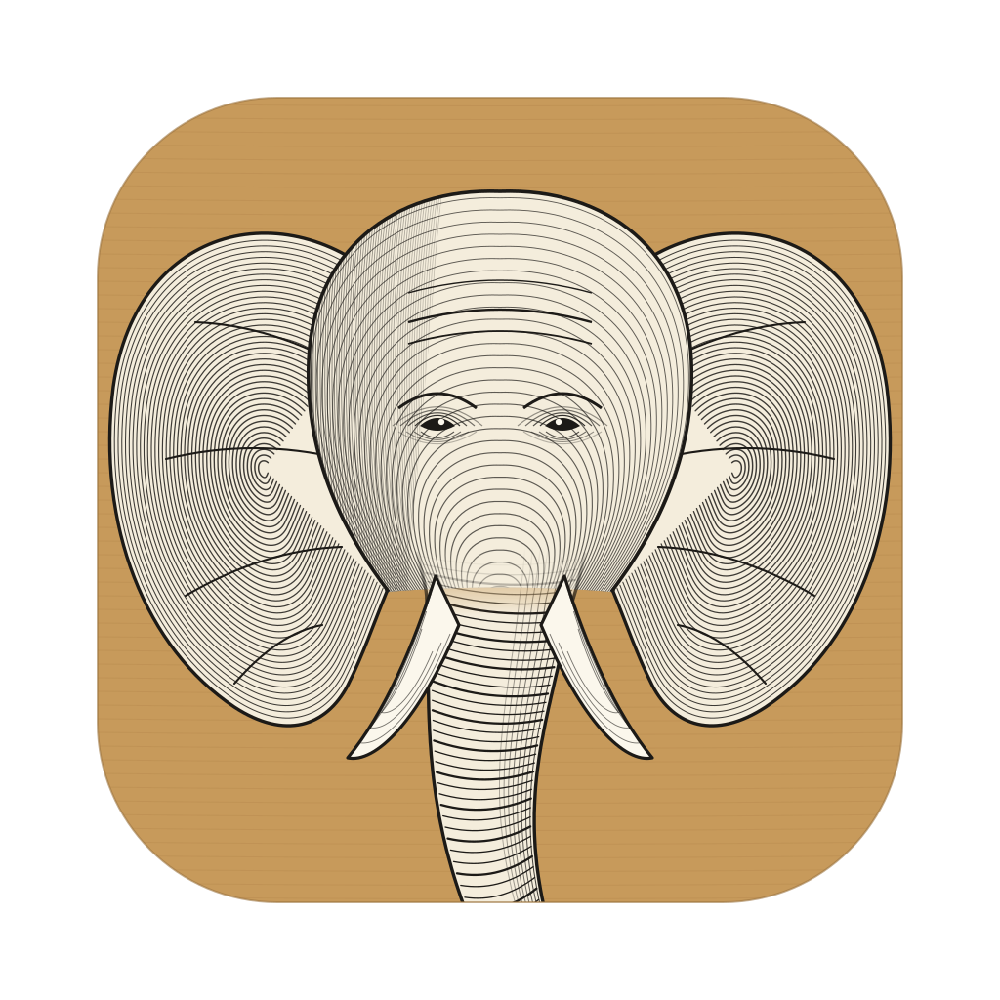
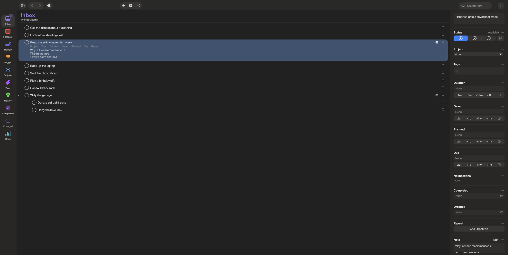
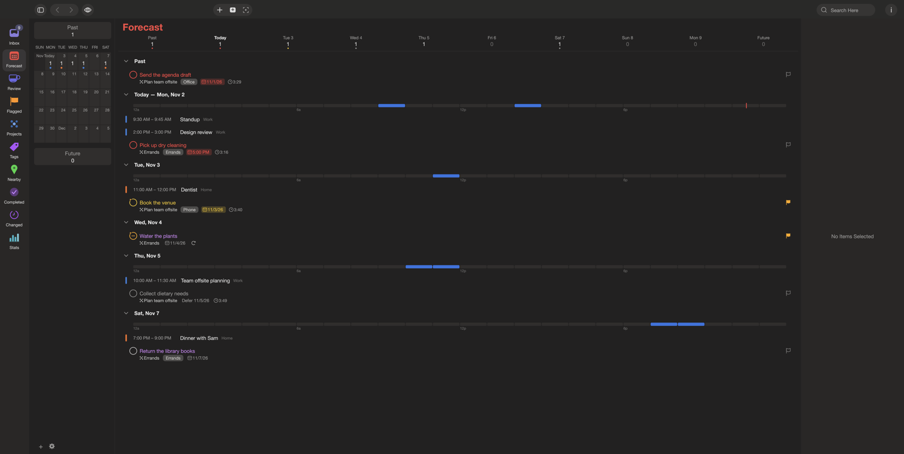
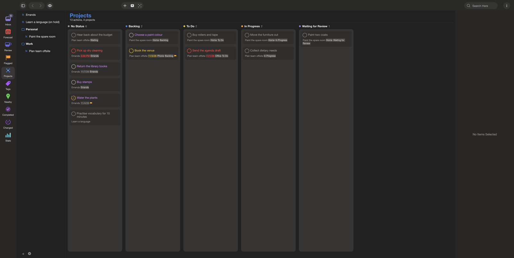
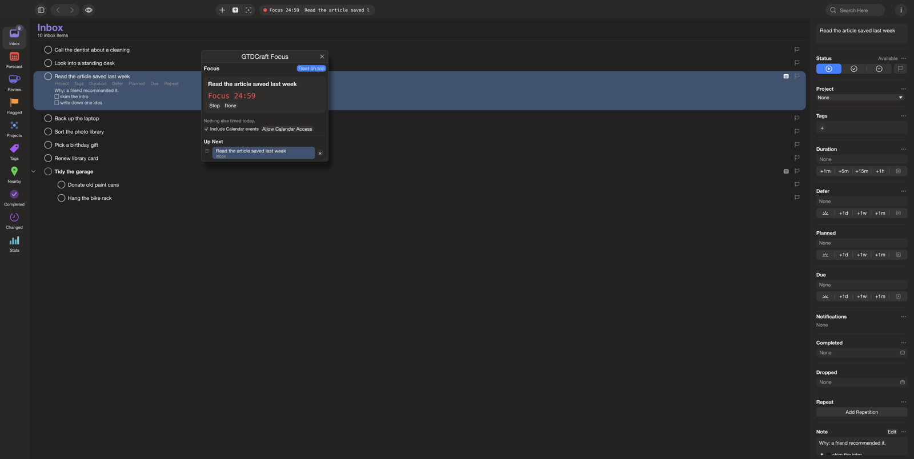
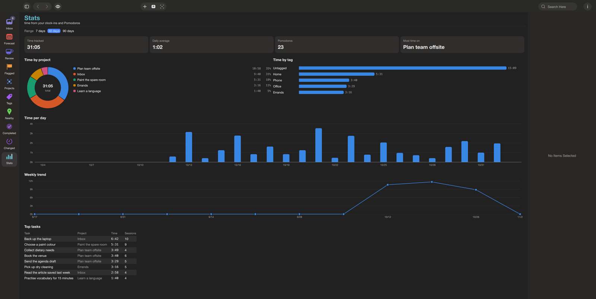
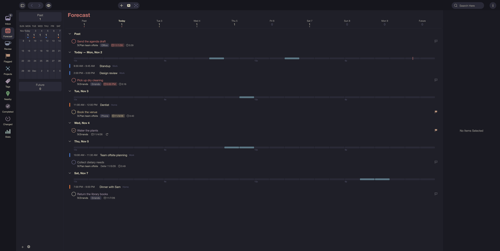
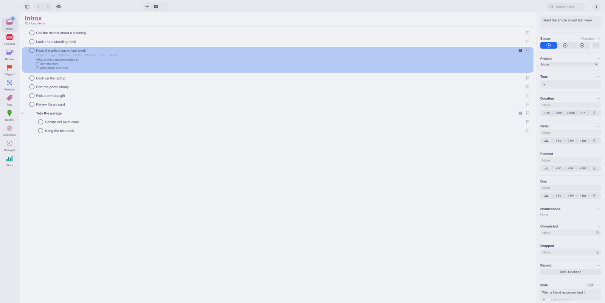
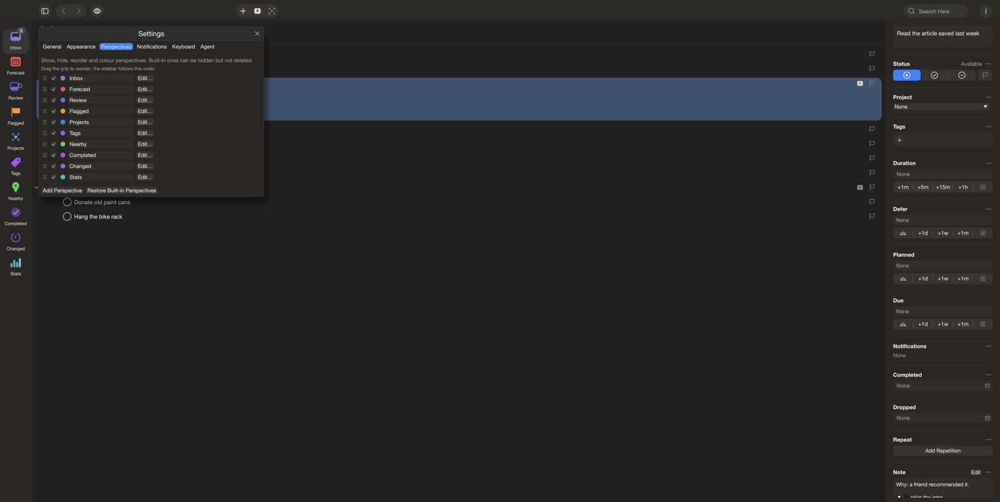

<p align="center">
  
</p>

<h1 align="center">GTDCraft</h1>

<p align="center">
  <b>Get things off your mind and done: a fast native task manager in pure Rust with an MCP server built in, so your agents can work your lists too.</b>
</p>

<p align="center">
  Inbox, projects, tags, Forecast with your calendar, review, perspectives you build from rules (or describe in plain
  words), boards with your own status columns, time tracking and Pomodoro, and a Focus window that floats over your
  work. One small binary on the GPU. Your data is one file you can read, diff, put in git, or sync with your own server.
</p>

<p align="center">
  
  
  
  
  
</p>

<p align="center">
  
  <br><sub><b>The sample database.</b> Perspectives on the left, your actions in the middle, the inspector on the right.</sub>
</p>

<p align="center">
  <a href="#a-tour">A tour</a> ·
  <a href="#why-gtdcraft">Why GTDCraft</a> ·
  <a href="#what-works-today">What works today</a> ·
  <a href="#quick-start">Quick start</a> ·
  <a href="#your-data">Your data</a> ·
  <a href="#for-agents">For agents</a> ·
  <a href="#architecture">Architecture</a> ·
  <a href="#how-it-is-tested">How it is tested</a> ·
  <a href="#status">Status</a> ·
  <a href="#credits">Credits</a>
</p>

## A tour

Every picture below is GTDCraft itself, drawn by its own `--screenshot` mode, not a mock-up.

<table>
<tr>
<td width="50%" valign="top"><p align="center"><sub><b>Forecast.</b> Your calendar events and your actions, day by day, with each day's busy hours drawn as a timeline.</sub></p></td>
<td width="50%" valign="top"><p align="center"><sub><b>Boards.</b> Any perspective as columns, including your own status sets (Status : Backlog, To Do, In Progress…). Drag a card to change its stage.</sub></p></td>
</tr>
<tr>
<td width="50%" valign="top"><p align="center"><sub><b>Focus.</b> A small window that can float on top: what you're doing, the Pomodoro, how long until your next meeting, and Up Next.</sub></p></td>
<td width="50%" valign="top"><p align="center"><sub><b>Stats.</b> Clock in and out org-mode style, run Pomodoros, and see where the time went.</sub></p></td>
</tr>
<tr>
<td width="50%" valign="top"><p align="center"><sub><b>Themes.</b> 38 built in (Tokyo Night, Catppuccin, Everforest, Gruvbox, Rosé Pine, Kanagawa, Nord, Dracula…) and your own as JSON.</sub></p></td>
<td width="50%" valign="top"><p align="center"><sub><b>Light and dark.</b> Perspective colours are adjusted per theme so they always read.</sub></p></td>
</tr>
<tr>
<td colspan="2" valign="top"><p align="center"><sub><b>Make it yours.</b> Drag perspectives and inspector sections into order, remap every shortcut, and build perspectives from rules.</sub></p></td>
</tr>
</table>

## Why GTDCraft

- **Fast.** A native Rust app drawn with [egui](https://github.com/emilk/egui). It opens instantly and stays out of your way.
- **Agents are first-class.** `gtdcraft --mcp` is an MCP server: add, update, complete and review tasks, build perspectives,
  read your calendar. The app picks up an agent's changes live.
- **Your data is a file.** One JSON, JSONC or JSON Lines file. Keep separate databases for work and home, try a new
  setup on a copy, and turn on git version history to go back to any earlier state.
- **A familiar workflow.** Inbox, projects (parallel, sequential, single actions), nested tags, defer / planned / due dates,
  repeats, review, flagged, Forecast, Nearby places, availability rules, and keyboard shortcuts for everything.
- **Plain-language perspectives.** Describe a view ("errands I can do this week") and Claude, any OpenAI-compatible
  model, or any ACP agent (Claude Code, Codex, Gemini CLI, Hermes, goose, OpenCode…) drafts its rules.

## What works today

| Area | What you get |
|---|---|
| **Organizing** | Inbox, projects in nested folders, action groups, nested tags (`Parent : Child`), drag projects between folders, multiple selection (⌘-click, ⇧-click), right-click menus |
| **Dates** | Defer, planned, due and repeat; typed dates ("tomorrow 5pm", "next fri", "+3h", "nov 15"); due-soon, overdue and inherited dates |
| **Perspectives** | Built-in Inbox, Forecast, Review, Flagged, Projects, Tags, Nearby, Completed, Changed, Stats; custom perspectives from a rule tree (all / any / none, availability, dates, tags, projects, text…) |
| **Boards** | Any perspective as a kanban board; columns by status, project, tag, or a status set of child tags; drag to move |
| **Calendar** | Your macOS calendars in Forecast (with busy-hour timelines), the Focus countdown and the agent tools; choose calendars, all-day events optional |
| **Time** | Clock in / out with a LOGBOOK, Pomodoro (work / short / long breaks), Stats with charts, a floating Focus window and an Up Next queue |
| **Notes** | Markdown with pictures and link cards |
| **Integrations** | Linear issues linked to tasks and projects, with status you can change from the inspector |
| **Files** | New / Open / Save As / Export (.json, .jsonc, .jsonl), git version history with restore, Sync Now |
| **Mac** | Native menu bar laid out like the classic one, notifications, places with maps, custom shortcuts, 38 themes |
| **Sync** | `gtdcraft --sync-server --token <secret>` on any machine; each device syncs in the background (per-record merge, deletes travel, settings stay per device) |
| **Status** | Lights for sync, decisions and agents at the foot of the rail (iPhone: the tab bar); tap for a summary and Retry. Settings › Status adds Check, Reset and Troubleshoot for every subsystem and connection |
| **iPhone and iPad** | The same app on iOS (one pane at a time on a phone); `./make-ios.sh` runs it in the simulator, `./make-ios-device.sh` installs it on a real iPhone or iPad |
| **Web activity** | A Chrome extension (`extension/chrome`) that tracks sites, searches and YouTube videos, on task or off, with your interests over time; Stats shows each one with a YouTube thumbnail and a clickable link, and agents can read it all |

## Quick start

```sh
cargo build --release
./target/release/gtdcraft            # the app
./make-app.sh                        # dist/GTDCraft.app with its icon
```

Useful flags: `--db <file>` (open a database), `--screenshot out.png` (draw ~120 frames, save, exit), `--view forecast`,
`--theme "Catppuccin Mocha"`, `--quick` (open Quick Entry), `--mcp` (MCP server on stdin / stdout),
`--sync-server --token <secret>` (sync server).

iPhone / iPad (simulator): `rustup target add aarch64-apple-ios-sim`, then `./make-ios.sh "iPhone 17 Pro"`.

iPhone / iPad (a real one): `rustup target add aarch64-apple-ios`, sign into Xcode with your Apple ID once
(Xcode › Settings › Accounts — a free one works, its builds last 7 days), run `./ios/setup.sh` once (it finds your
team and writes the git-ignored `ios/Config/Local.xcconfig` with your own bundle ID and App Group; `--dry-run` shows
it first), unlock the phone, then `./make-ios-device.sh`. It builds with `ios/project.yml` (XcodeGen), which wraps the Rust binary, then installs and
launches it with `devicectl`. The build number and version come from `Cargo.toml` and the commit count.

The sync server: `./target/release/gtdcraft --sync-server --listen 0.0.0.0:8765 --token <secret>` (or
`GTDCRAFT_SYNC_TOKEN`), data in `~/Library/Application Support/GTDCraft/sync-server/gtdcraft.jsonl`.
`GET /v1/health` says `{"ok":true}` (with the token, it also lists each subsystem: sync, decisions, agents, so a dead Clef or agent never stops syncing), `POST /v1/sync` takes a database and returns the merged one. Point every device at
`http://<this-mac>.local:8765` with the same token in Settings › Sync.
Devices that drifted apart offline: [docs/SYNC-RECOVERY.md](docs/SYNC-RECOVERY.md) (3-way merge with `tools/merge3.py`).

## Your data

Everything lives in one file, by default `~/Library/Application Support/GTDCraft/gtdcraft.json`. The format follows
the extension: `.json`, `.jsonc` (comments allowed) or `.jsonl` (one record per line, which diffs cleanly in git).
File › Keep Version History commits your database to git after each burst of edits; File › Version History restores
any version.

## For agents

```sh
claude mcp add gtdcraft -- /path/to/gtdcraft --mcp
```

Tools include `gtd_overview`, `gtd_list_tasks`, `gtd_add_task`, `gtd_update_task`, `gtd_set_status`, `gtd_review`,
`gtd_create_perspective`, `gtd_link_linear`, `gtd_calendar_events`, `gtd_web_activity` and `gtd_decide`. The MCP server always works on the
database the app last opened.

**Decisions (System One).** Off until you turn it on in Settings › Agent › Decisions. A decision model answers typed questions
(yes/no, one of several, a score) with a probability for each answer. Pick Clef on this Mac (`python clef_mlx.py serve --port 8001`
from the `mlx-community/clef-flash-4bit` folder), Cloudflare Clef, TypeSafe Jev, Fireworks Rune, or any `/v1/systemone` server,
and press Test. Agents ask it through `gtd_decide`. The settings sync, so iPhone and iPad use the same provider; for Clef on the Mac
they go through the sync server (`--sync-server --clef-url http://127.0.0.1:8001`).

## Architecture

| Piece | Where |
|---|---|
| Model, availability rules, repeats | `src/model.rs`, `src/rules.rs`, `src/dates.rs` |
| Window, outline, inspector | `src/main.rs`, `src/fields.rs`, `src/board.rs`, `src/editor.rs`, `src/focus.rs` |
| Files, git, menus | `src/dbfile.rs`, `src/dbui.rs`, `src/menu.rs` |
| MCP server | `src/mcp.rs` |
| Calendar | `src/calendar.rs` and the small `gtdcraft-calendar` helper app (it asks macOS for Calendar access as its own app) |
| Themes | `src/theme.rs`, `themes/*.json`, `themes/make_popular.py` |
| Sync | `src/sync.rs` (merge, client, `--sync-server`) |
| Status | `src/status.rs` (lights, Settings › Status, troubleshooting) |
| iOS | `make-ios.sh`, `src/menu_ios.rs`, `.cargo/config.toml` |
| Web activity | `extension/chrome` (the extension), `src/webact.rs` (GTDCraft's receiver and summary) |

How it behaves, value by value, with where each rule came from: [MECHANICS.md](MECHANICS.md).

## How it is tested

`cargo test` runs the model, rule, date, file-format, git, menu, drag-and-drop, calendar and MCP tests (headless egui
runs real pointer events through the drag lists and menus). `--screenshot` renders the app for visual checks.

## Versioning

The version lives in `Cargo.toml` (semver: features bump the minor, fixes the patch). The app shows it with the
commit's short SHA in the bottom-right corner; click it to open that commit here.

## Status

A beta, used daily. Not built yet: Apple Watch, an App Store / TestFlight build (real devices install through
`make-ios-device.sh` with a personal team's 7-day build), and calendars on iOS.

## License and credits

GTDCraft is dual-licensed under [MIT](LICENSE-MIT) or [Apache-2.0](LICENSE-APACHE), at your option.
Copyright (c) 2026 Matt Petters and the GTDCraft contributors. Required notices are in [NOTICE](NOTICE).

Clean-room: built from public documentation and observed behaviour, with original code and assets.

Made by Matt Petters with Claude. Built on [egui](https://github.com/emilk/egui) / eframe, chrono, serde, muda, rfd and
objc2. Theme colours come from each scheme's authors via
[iTerm2-Color-Schemes](https://github.com/mbadolato/iTerm2-Color-Schemes); Kanagawa Paper from
[kanagawa-paper.nvim](https://github.com/thesimonho/kanagawa-paper.nvim).

<sub>GTD® and Getting Things Done® are registered trademarks of the David Allen Company. OmniFocus is a trademark of
The Omni Group. GTDCraft is an independent, open-source project and is not affiliated with, sponsored by or endorsed by
the David Allen Company or The Omni Group; these names are used only to describe the method and the kind of app it
works with.</sub>
